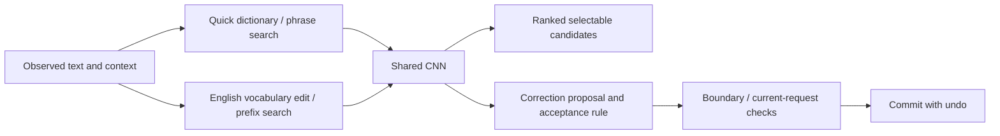

# Candidate and autocorrect review — 2026-10-20

The core can stay small: one language model, explicit candidate generators,
one correction decision and editor-state protection. Several older implementations
are unnecessary in the production app. The current automatic-correction heuristics
are not supported by the old 99.4% synthetic precision claim on real mobile data.

The initial review changed source organization and removed unsupported revision
work. The subsequent [typing iteration](ENGLISH_TYPING_ITERATION.md) adopts a
fitted F₀.₅-selected acceptance rule and removes the prefix-completion penalty.
Known-word protection remains; phone verification is still unavailable.

## Live pipeline and component decisions



`KeyboardSessionController` constructs `SharedLmEnglishEngine`, not
`InternalTypingProfile` or `NativeEnglishEngine`. Kotlin handles composition,
editor boundaries and async state; Rust generates/ranks candidates. Quick maps
codes with Quick3/5 dictionaries and searches phrases for longer input. English
uses TRAIN-attested English words already embedded in the shared CNN vocabulary.
The handwriting visual recognizer remains a separate necessary input model; its
language priors use the same CNN weights. This audit did not evaluate stroke
recognition quality.

| Component | Decision | Evidence or reason |
| --- | --- | --- |
| One shared contextual LM | Keep | Removing context substantially reduces Quick, English-prefix and next-word accuracy below. |
| Quick dictionaries | Keep | Map shape codes to all possible characters; the LM cannot supply that mapping. |
| Spelling/edit generator | Keep | The LM ranks a finite candidate pool; missing answers cannot be recovered by threshold changes. Only 1,053/1,424 recorded typo targets reach its top eight. |
| Known-word preservation | Keep for this model | Removing the veto causes 548 unwanted preservation changes instead of 47. This does not prove known-word mistakes are unfixable; their replacement policy needs better evidence. |
| Undo, editor eligibility, request/version/session checks | Keep | These prevent text corruption, stale writes, password/URI corrections and repeat corrections after Undo. They are correctness requirements, not linguistic heuristics. |
| Boundary queue / 40 ms deadline | Keep | In-flight correction must resolve without blocking subsequent editor events indefinitely. Dataset word probes do not establish on-device deadline behavior. |
| Previous-word revision machinery | Skip for unsupported engines | The live shared causal engine advertises no revision support. Previously it still built history, read editor text and queued work that returned null. This is now bypassed. |
| Old dictionary loaders, joint decoder, forest, separate policies, local-learning implementation | Remove from production sources | The retired Kotlin files, Rust English module, JNI exports, old dictionary fixtures and evaluation tools are deleted. The `legacy-typing` feature and trial build switch are removed. |
| Keyboard-neighbour penalties and conditional acceptance margins | Not yet justified individually | Uniform edit cost improves diagnostic precision but loses recall; neither qualifies a replacement. These constants need training/calibration evidence, not more handwritten exceptions. |
| Split-word rules | Not adequately evaluated here | Removing them improves the single-word diagnostic, but this corpus extraction labels one reference word and excludes multiword targets. It cannot establish merged-word quality. Retain pending a correctly labelled merged-word evaluation. |
| Slow full ranking after short-code preview | Small measured benefit; retain provisionally | Adds one top-1 and two top-eight successes in 500 cases, at much higher cost. The panel is too small to establish a reliable quality-equivalent removal. Keep it asynchronous so first display does not wait. |

## Data and evaluation repairs

Autocorrection uses the SSD copy of the [Aalto ITE dataset](https://zenodo.org/records/12528163).
Its [documentation](https://zenodo.org/records/12528163/files/README-datasets.md?download=1)
defines `TYPED_WORD` as input before correction, `AC_WORD` as the other keyboard's
output and `ORIGINAL_WORD` as the reference. `AC_WORD` is never treated as truth.
`TEST_SECTION_ID` identifies a trial, not a person.

The frozen diagnostic selects 1,500 recorded AC events and 1,500 reference-prompt
word preservation controls: 1,424 typo cases and 1,576 preservation cases over
1,074 prompt IDs. Intake scans 489,414 events; it excludes unsupported token
formats and 7,477 ambiguous current-word suffixes. It removes the observed
composing suffix from `CURRENT_INPUT`, retaining the actual preceding context.
Clean contexts use regex occurrence positions, not `sentence.find(word)`.
Targets are not filtered by model membership or injected into retrieval.

Sampling uses a frozen seed, a per-prompt event cap and an unused prompt hash
partition. There is no fitting or threshold search. Historical Aalto exposure
prevents calling this a fresh test. The missing participant map prevents claims
of person-disjoint evaluation. The AC table is selected by other keyboards'
interventions and does not represent all mobile keystrokes. Prompt-copy controls
are not certified typo-free text. Aggregate precision depends on this artificial
event/control mixture; it is not an estimate of production population precision.

The older `dataset/keyboard-lm/eval_autocorrect_v88.py` is not an acceptance gate:
it passes `CURRENT_INPUT` including the typed word as preceding context, calls
trial IDs participants, does not implement its claimed disjoint splits, and
validates cached predictions by length only. Its clean-word `find` also chooses
the first occurrence when a word repeats. The new audit binds model, probe,
sources and code hashes, rejects native/mirrored-policy disagreement, has no
prediction cache, and retains missing targets in the denominators.

Candidate ranking uses only external SSD development files:

- 500 Quick cases, 100 per source: Wiki, LIHKG, OpenRice, Common Voice and Common
  Crawl. Both Quick3/5 are represented; cases are capped at one per document
  within a source. All dictionary match sets are checked for exact preservation.
- 750 prediction cases: 150 each for English/mixed English-prefix suggestions,
  and Cantonese/English/mixed shared next-word suggestions. Canonical context
  tokens are reconstructed with whitespace; target vocabulary coverage is not
  used as a filter.
- Existing protected confirmation/test files were not opened. These development
  sources may have historical model/tuning exposure. No language/script conversion
  is applied. Latency is host engine time, not IME input-to-display time.

## Results

Native spelling decisions are replayed over the full returned pool, with an exact
decision-parity assertion before ablations. Removing an LM below removes its
ranking score, not the vocabulary it supplied. Ablations share the current
retrieval pool; they are not independent replacement systems.

| Frozen diagnostic policy | Correct / applied changes | Precision | Typo recall | Unwanted preservation changes / 1,576 |
| --- | ---: | ---: | ---: | ---: |
| Current native policy | 633 / 840 | 75.36% | 44.45% | 47 (2.98%) |
| Without split rules | 639 / 822 | 77.74% | 44.87% | 44 (2.79%) |
| Without known-word veto | 702 / 1,475 | 47.59% | 49.30% | 548 (34.77%) |
| Uniform edit cost; no splits | 565 / 698 | 80.95% | 39.68% | 29 (1.84%) |
| Edit-only ranking; no splits | 247 / 330 | 74.85% | 17.35% | 33 (2.09%) |
| Simple one-edit + fixed margin/probability floor | 204 / 221 | 92.31% | 14.33% | 7 (0.44%) |

None reaches the existing 95% aggregate precision criterion. The last policy
reduces harm but loses most corrections. It is not promoted. On recorded typo
events alone the current policy is 633/793 correct (79.82%); excluding preservation
errors gives a misleadingly higher precision than the complete diagnostic.
Single-word labels also limit interpretation of split-word predictions.

| Quick ranking | Top 1 | Top 3 | Top 8 | Median host engine time | p95 |
| --- | ---: | ---: | ---: | ---: | ---: |
| Dictionary order | 58.2% | 81.0% | 93.8% | — | — |
| Fast shared-model preview | 77.2% | 89.6% | 95.4% | 2.78 ms | 3.34 ms |
| Full sequence ranking | 77.4% | 89.8% | 95.8% | 223.13 ms | 622.96 ms |

The 0.2-point full-ranking top-1 difference is one case, not evidence of a robust
population improvement. The preview preserves every match. No dictionary-only
replacement is justified by these results. Corpus contexts differ from the
earlier `df` microbenchmark, so the two timing tables should not be conflated.

| Context ablation, 150 cases per panel | Top 8 with context | Top 8 with empty context |
| --- | ---: | ---: |
| English prefix | 82.0% | 57.3% |
| English prefix in mixed text | 38.7% | 22.0% |
| Shared next-word, Cantonese | 18.0% | 5.3% |
| Shared next-word, English | 37.3% | 0.0% |
| Shared next-word, mixed | 16.0% | 7.3% |

Next-word measurements follow the mixed/shared prediction path. They do not
measure English-only next-word filtering or complete controller behavior. Mixed
quality remains weak despite clear contextual gains. These aggregate panels do
not qualify the model or a new policy.

## Changes, verification and next evidence

Initially moved seven retired implementations into test-only sources; these and their retired-only tests have now been deleted. Also
separated the live `EnglishCandidateEngine` contract from the retired loader;
bypassed unsupported context-revision work; added its regression test; added
reproducible dataset audits and intake/decision tests. Corrected the stale pipeline
documentation and removed duplicated, incorrect threshold claims from staging
metadata. The native implementation remains the decision source of truth.
The old 99.43% precision report was a synthetic development audit of an earlier
policy; it is not current mobile-data qualification.

The focused coordinator/shared-engine/deadline tests and `:app:verifyKeyboard`
pass. The source-archival change additionally compiles Android instrumentation
tests. The subsequent learned acceptance rule is included in the rebuilt Android
library and debug APK. No phone was connected; nothing was installed on a phone.

The next simplification decision should use a correctly aligned merged-word
cohort, person-disjoint mobile validation where the participant mapping is
available, and a larger paired Quick panel focused on the cases where preview and
full ranking disagree. Fit a small acceptance rule on TRAIN only and report both
precision and recall on a frozen evaluation set. Adding another model, forest or
dictionary is not supported by this review.

Reproduce with the release `ngram_probe` from the sibling Rust crate:

```sh
python3 scripts/audit_candidate_pipeline.py --probe /path/to/ngram_probe --output build/pipeline-audit
python3 scripts/audit_prediction_context.py --probe /path/to/ngram_probe --output build/pipeline-audit/prediction-context.json
python3 -m unittest discover -s scripts -p test_audit_candidate_pipeline.py
./gradlew :app:verifyKeyboard :app:compileDebugAndroidTestKotlin
```

Machine-readable, hash-bound results are in
[`config/pipeline_audit/2026-10-20/report.json`](config/pipeline_audit/2026-10-20/report.json)
and [`prediction-context.json`](config/pipeline_audit/2026-10-20/prediction-context.json).
Raw selected text and native results remain in the local ignored build directory.
