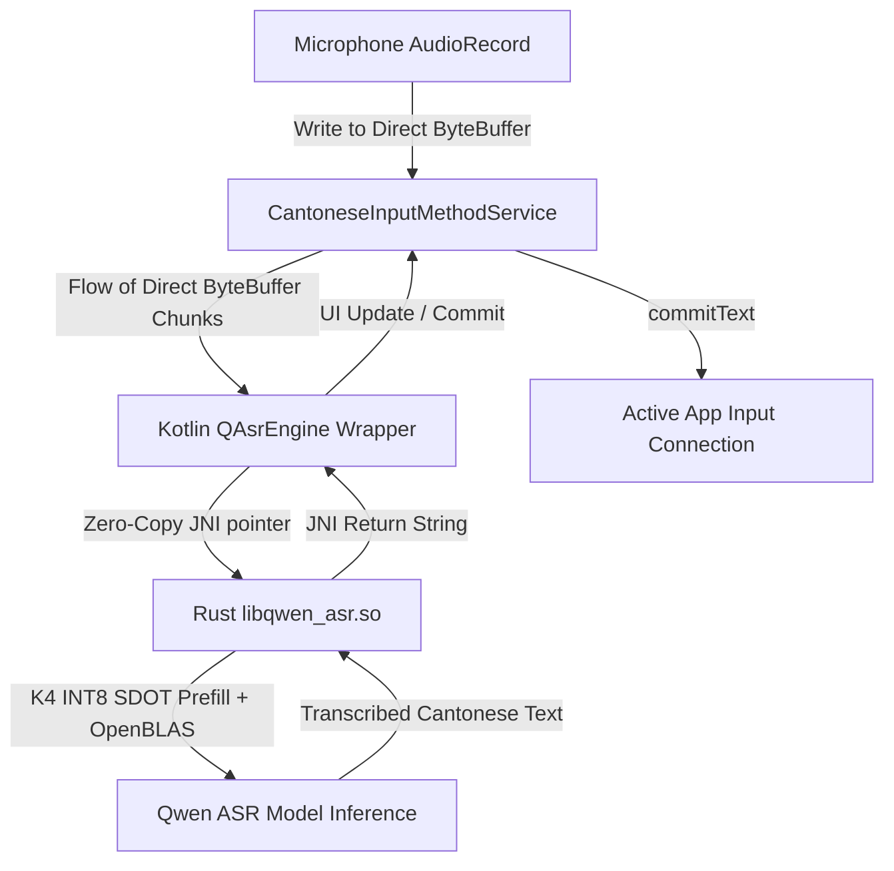

# Cantonese Voice Input Keyboard Implementation Plan

This document outlines the detailed architecture and step-by-step implementation plan for building a premium, on-device Cantonese Voice Input Keyboard on Android. It leverages the state-of-the-art `QwenASR` model and integrates the best performance baseline established in `android_experiment` (K4 INT8 SDOT prefill).

> [!NOTE]
> This plan focuses entirely on local, on-device transcription to ensure ultra-low latency, 100% privacy, and offline capability.

---

## Architecture & Data Flow

To maximize efficiency and satisfy performance requirements, we will implement **zero-copy JNI memory access**. The following diagram illustrates how the system modules interact, from raw microphone audio to keyboard text input.



---

## 1. Native Build & Best Baseline Setup (The Core)

We will integrate the absolute best benchmark baseline from the `android_experiment` findings: **K4 INT8 SDOT Prefill** with static OpenBLAS linking and dynamic projection transient dequantization.

### Native Target & Features
- **ABI Target**: `arm64-v8a` (Android 64-bit ARM)
- **Rust Flag Extra**: `RUSTFLAGS_EXTRA="-C target-feature=+dotprod"` (essential for ultra-fast dot product operations on modern ARM CPUs).
- **BLAS Backend**: Static OpenBLAS (`libopenblas.a`) compiled for `TARGET=ARMV8`, `OSNAME=Android`, `BINARY=64`, `ONLY_CBLAS=1`, `NOFORTRAN=1`, `USE_THREAD=0`, `NUM_THREADS=1`.
- **Model Quantization Configuration**: Zero-copy INT8 projections + pre-fused gate+up MLP tensors + transient prefill dequantization to shared `F32` scratch buffers.

### Step-by-Step Native Wrapper Setup
1. **Rust Cargo NDK Compilation**:
   We will build `libqwen_asr.so` (or a dedicated JNI library wrapper `libqwen_asr_jni.so`) using `cargo ndk` pointing to Android NDK version `29.0.14206865`.
   ```bash
   OPENBLAS_ANDROID_LIB_DIR=/private/tmp/OpenBLAS \
   OPENBLAS_ANDROID_STATIC=1 \
   RUSTFLAGS="-C target-feature=+dotprod" \
   cargo ndk -t arm64-v8a -o app/src/main/jniLibs build --release --features "blas android"
   ```
2. **Zero-Copy JNI Buffer Access**:
   To avoid buffer copying between the JVM heap and Rust native memory, we will pass audio data using **Direct ByteBuffers** (`java.nio.ByteBuffer.allocateDirect()`). On the Rust side in `jni_api.rs`, we will access this direct pointer using `GetDirectBufferAddress(env, buffer)` rather than standard `GetFloatArrayElements`.
3. **Model Assets Delivery**:
   We will push the pre-quantized Cantonese ASR model directory (`qwen-asr-int8dec`) directly to the application's external files directory:
   ```bash
   adb push /Volumes/SSD/qwen-asr-int8dec /sdcard/Android/data/com.example.cantonesevoicekeyboard/files/qwen-asr-int8dec
   ```
   The keyboard service will access the model directly via `context.getExternalFilesDir(null)`.

---

## 2. Kotlin Wrapper API (`QAsrEngine`)

We will define a robust Kotlin wrapper that interfaces with the native library. It uses a direct JVM buffer to prevent GC allocations and copies.

```kotlin
package com.qwenasr

import android.util.Log
import java.nio.ByteBuffer

class QAsrEngine {
    companion object {
        init {
            try {
                System.loadLibrary("qwen_asr")
            } catch (e: UnsatisfiedLinkError) {
                Log.e("QAsrEngine", "Failed to load qwen_asr native library", e)
            }
        }
    }

    private var nativeHandle: Long = 0

    /**
     * Initializes the Qwen ASR model from a directory.
     * @param modelDir Absolute path to the model folder.
     * @param nThreads Execution thread count (defaults to CPU cores if <= 0).
     */
    fun loadModel(modelDir: String, nThreads: Int): Boolean {
        nativeHandle = nativeLoadModel(modelDir, nThreads)
        return nativeHandle != 0L
    }

    /**
     * Transcribe direct byte buffer contents without copying memory.
     * @param directBuffer A Direct ByteBuffer containing 16kHz mono float PCM samples.
     * @param sizeInSamples Number of float samples in the buffer.
     */
    fun transcribePcmDirect(directBuffer: ByteBuffer, sizeInSamples: Int): String? {
        if (nativeHandle == 0L || !directBuffer.isDirect) return null
        return nativeTranscribePcmDirect(nativeHandle, directBuffer, sizeInSamples)
    }

    /**
     * Set ASR configurations.
     */
    fun setLanguage(language: String) {
        if (nativeHandle != 0L) nativeSetLanguage(nativeHandle, language)
    }

    fun setSegmentSec(sec: Float) {
        if (nativeHandle != 0L) nativeSetSegmentSec(nativeHandle, sec)
    }

    /**
     * Free native memory allocations.
     */
    fun free() {
        if (nativeHandle != 0L) {
            nativeFree(nativeHandle)
            nativeHandle = 0L
        }
    }

    private external fun nativeLoadModel(modelDir: String, nThreads: Int): Long
    private external fun nativeTranscribePcmDirect(handle: Long, buffer: ByteBuffer, size: Int): String?
    private external fun nativeSetLanguage(handle: Long, language: String)
    private external fun nativeSetSegmentSec(handle: Long, sec: Float)
    private external fun nativeFree(handle: Long)
}
```

---

## 3. Android Input Method Editor (IME) Service

We will implement the keyboard service in strict accordance with **Modern Android Development (MAD)** architecture guidelines.

### Modern Android Architecture (MAD) Integration
1. **Unidirectional Data Flow (UDF)**:
   The Keyboard UI will observe state from a dedicated state holder (e.g. a `KeyboardViewModel` or equivalent service-scoped StateFlow), exposing UI states like `Idle`, `Recording(volumeLevel)`, `Transcribing`, and `Error(message)`.
2. **Coroutines & Flows**:
   Asynchronous tasks such as live audio recording, engine inference, and text committing will be scheduled on proper Dispatchers (`Dispatchers.Default` for engine tasks, `Dispatchers.IO` for logging/file loading) using Kotlin `Flow` to stream data reactively.
3. **Jetpack Compose UI Layout**:
   Use declarative Compose elements with proper State Hoisting to ensure the layout remains testable, clean, and decoupling UI logic from system service binders.

### Dynamic Visibility Memory Lifecycle (RAM Optimization)
Since model load time is extremely fast (~128 ms) and background memory retention is costly, we will dynamically manage model loading based on keyboard visibility:
- **Load Model on Show**: Inside `onStartInputView(...)` (when the keyboard becomes visible on screen), we will initiate an asynchronous Kotlin coroutine to load `QAsrEngine` from external files.
- **Free Model on Hide**: Inside `onFinishInputView(...)` or `onWindowHidden()` (when the keyboard is hidden from the user), we will immediately call `QAsrEngine.free()` to release native pointers and free all ASR memory (~500MB+ RAM), ensuring our idle footprint is near zero.

### Service Registration (`AndroidManifest.xml`)
```xml
<service
    android:name=".CantoneseInputMethodService"
    android:label="@string/keyboard_name"
    android:permission="android.permission.BIND_INPUT_METHOD"
    android:exported="true">
    <meta-data
        android:name="android.view.im"
        android:resource="@xml/method" />
    <intent-filter>
        <action android:name="android.view.InputMethod" />
    </intent-filter>
</service>
```

---

## 4. UI Design & Premium Aesthetics

We will build a high-fidelity, premium keyboard interface using **Jetpack Compose** that looks spectacular in both light and dark modes.

### Key UI Features
1. **Dynamic Glassmorphism**: Translucent panels utilizing system-level backing blur when active.
2. **Interactive Audio Waveform**: A real-time micro-animated canvas displaying live microphone volume levels while recording.
3. **Hold-To-Speak Trigger**: The recording is triggered by **pressing and holding** the central microphone button. It incorporates smooth scale and glow micro-animations reflecting active recording state.
4. **Haptic Engine Integrations**: Subtle keypress haptic feedback to match standard system keyboards.

---

## 5. Companion Setup App (UX Flow)

Because a keyboard cannot directly launch a permission dialog while active, we will create a dedicated setup app inside the Launcher Activity (`MainActivity`) to guide the user through a frictionless 3-step setup:

1. **Step 1: Request Permissions**: Grant `RECORD_AUDIO` via an aesthetic permission explanation card.
2. **Step 2: Enable Keyboard**: Launch the System Language & Input Settings using `Intent(Settings.ACTION_INPUT_METHOD_SETTINGS)`.
3. **Step 3: Select Keyboard**: Show the standard system IME picker so the user can activate our keyboard immediately.
4. **Interactive Sandbox**: A text input box where the user can test the voice input right inside the app before general usage.

---

## Verification & Deployment Plan

### Automated Deploy & Run Script (`deploy.sh`)

We will create a robust shell script `deploy.sh` in the root of the project to completely automate native compilation, model asset preparation, APK building, installation, and launching in a single command.

#### [NEW] [deploy.sh](file:///Users/tony/Documents/keyboard/cantonese-voice-keyboard/deploy.sh)
The script will perform the following actions:
1. **Compile Rust JNI Library**: Runs `cargo ndk` with baseline features (`blas`, `android`) and target options (`+dotprod`) statically linked with OpenBLAS inside the `QwenASR` crate workspace, outputting the generated `libqwen_asr.so` to `/app/src/main/jniLibs/arm64-v8a/`.
2. **Push Model via ADB**: Automatically verifies/creates the destination path on the connected device and syncs the pre-quantized Cantonese model (`qwen-asr-int8dec`):
   ```bash
   adb shell "mkdir -p /sdcard/Android/data/com.example.cantonesevoicekeyboard/files"
   adb push /Volumes/SSD/qwen-asr-int8dec /sdcard/Android/data/com.example.cantonesevoicekeyboard/files/
   ```
3. **Build & Install APK**: Compiles the Gradle project and installs the debug app:
   ```bash
   ./gradlew installDebug
   ```
4. **Launch Main Setup App**: Opens the main configuration activity:
   ```bash
   adb shell am start -n com.example.cantonesevoicekeyboard/.MainActivity
   ```

### Real End-to-End Instrumented Test
We will implement an on-device instrumented test (`QAsrEngineE2ETest`) that runs on a physical target or high-performance arm64 emulator without mocking:

1. **No-Mock Engine Load**: The test loads the actual native `libqwen_asr.so` and instantiates `QAsrEngine` pointing to the full, non-mocked Cantonese model located at `/sdcard/Android/data/com.example.cantonesevoicekeyboard/files/qwen-asr-int8dec/`.
2. **Accuracy Verification**: The test feeds a real 16kHz float PCM wave buffer (loaded from assets) containing a Cantonese utterance (e.g. `"Hello，你好吗？已经坐低咗啦。"`). It asserts that the resulting transcription exactly matches the expected text.
3. **Performance & Latency Benchmark**:
   - The test measures total time elapsed during the `transcribePcmDirect` call.
   - It asserts that the median inference latency is in line with the baseline (e.g. **< 1.7 seconds** for the common voice benchmark dataset) to ensure target optimizations (`+dotprod` and transient prefill dequantization) are actively compiling and executing successfully.

### Compose Screenshot Testing

We will implement Compose Screenshot Testing in accordance with Android Studio specifications to verify our premium keyboard layouts and ensure there are no visual regressions in our glassmorphic panel styling across different screen resolutions and light/dark theme combinations:

1. **Gradle Configuration**: We will add the screenshot testing plugin inside `app/build.gradle.kts` and define dependency rules:
   ```kotlin
   plugins {
       id("com.android.compose.screenshot") version "0.0.1-alpha08" // Or latest preview version
   }
   ```
2. **Declaring Screenshot Tests**: We will create preview screenshots inside `app/src/screenshotTest/kotlin/` using `@Preview` configurations for the keyboard in `Idle`, `Recording` (pulsing states), and `Transcribing` states.
3. **Execution Commands**:
   * **Update Reference Images**: Run `./gradlew updateDebugScreenshotTest` to generate reference baseline images.
   * **Verify Correctness**: Run `./gradlew validateDebugScreenshotTest` to capture current layout outputs and perform high-precision pixel-by-pixel comparisons against baselines.


